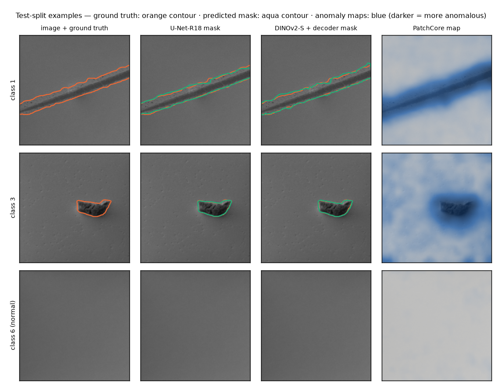
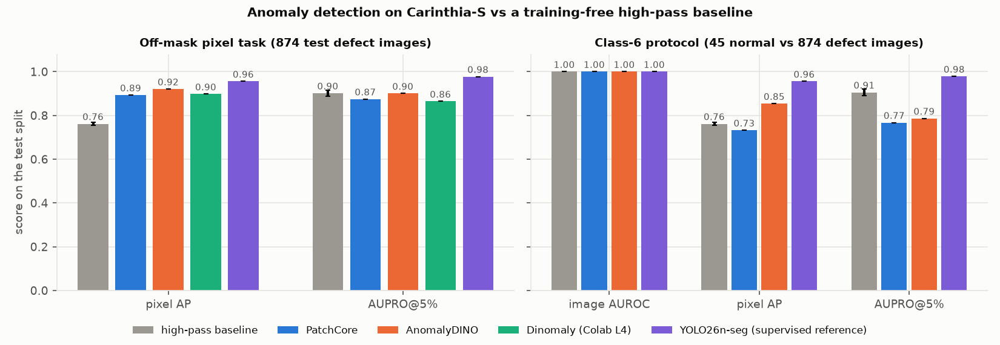

# SEM Defect Inspection

Finds, outlines and classifies defects in scanning-electron-microscope (SEM) images of semiconductor wafers,
benchmarked on the public Carinthia-S dataset (4,591 images with expert masks). A C++/CUDA/TensorRT engine
runs the anomaly detector 3.1× faster than PyTorch with practically identical scores.



*Test images (defect classes 1 and 3, and a defect-free class-6 image): ground-truth outline (orange), masks
predicted by a U-Net-R18 and by a frozen DINOv2-S with a small decoder (aqua), and the PatchCore anomaly map
(darker blue = more anomalous).*

## Results at a glance

All numbers are on the held-out test split (919 images; 874 with defects) and come from `outputs/`; full
tables and confidence intervals are in [REPORT.md](REPORT.md).

| task | result | compared with | takeaway |
|---|---|---|---|
| Defect segmentation | Dice **0.953**, frozen DINOv2-S + 0.79 M-param decoder | U-Net-R18 trained end to end: 0.952 | frozen foundation features match a fully trained U-Net; no false positives on defect-free images |
| Classification, 20 labels per class | 4-class macro-F1 **0.921**, DINOv2-S cosine 1-NN (no training) | fine-tuned ResNet-18, same labels: 0.853 | with few labels, frozen features beat fine-tuning |
| Classification, full train split (2,753 images) | 4-class macro-F1 **0.968**, fine-tuned ResNet-18 | DINOv2-S cosine 1-NN: 0.960 | with all labels, fine-tuning wins narrowly |
| Anomaly localisation, no defect labels | pixel AP **0.921**, AnomalyDINO | training-free high-pass baseline: 0.762 | learned detectors rank defect pixels better... |
| ... same task, low false-positive rate | AUPRO@5 % **0.900**, best learned detector | training-free high-pass baseline: 0.902 | ...but none beats the baseline at 5 % FPR |
| Robustness to SEM shot noise (dose 200 e⁻) | segmentation Dice **0.05–0.11** (clean: 0.95) | — | every trained model collapses; noise augmentation is needed |
| Deployment: PatchCore, raw image → score, batch 1 | **3.79 ms** (C++/CUDA/TensorRT, FP16) | PyTorch FP32 11.91 ms, PyTorch FP16 9.57 ms | 3.1× faster; 2.5× of it is engineering, not lower precision; image scores r = 0.999996 vs FP32 |
| Defect detection (boxes), 5 detectors on a Colab L4 | mAP50 **0.890** at 11.1 ms, YOLO26n | class-agnostic mAP50 0.92–0.93 for all five | all five find defects equally well; class-aware mAP hinges on two classes with 3 test images in total |

## Key findings

* **The usual anomaly benchmark is too easy here.** The defect-free images are featureless, so a training-free
  high-pass filter separates them from defect images perfectly (image AUROC 1.000). The informative task is
  pixel-level localisation inside defect images.
* **Foundation-model features are the right default when labels are scarce.** Frozen DINOv2 features beat a
  fine-tuned CNN with 20 labels per class and match a trained U-Net for segmentation; fine-tuning only pulls
  ahead with the full labelled set.
* **Speed-ups are reported against precision-matched baselines.** Of the 3.1–3.4× end-to-end gain, 1.2–1.7×
  comes from FP16 and 2.1–2.5× from fused CUDA kernels, TensorRT and a tensor-core kNN.
* **Limitation:** one production layer of unpatterned wafers, two classes with only 2 and 1 test images, and
  single runs for the learned anomaly detectors and all Colab models; nothing here shows transfer to patterned
  layers.

## Method

**Python benchmark (`src/semdefect/`)**

* *Splits*: stratified 60/20/20 per class (≥ 1 val/test image per class), 3 split seeds; nested few-shot
  supports (k = 1, 5, 10, 20; 5 seeds) drawn from train only.
* *Classification*: frozen DINOv2 ViT-S/14 and ViT-B/14 `[CLS ; mean-patch]` descriptors with a linear probe,
  nearest prototypes and cosine 1-NN, vs ResNet-18 / ConvNeXt-T fine-tuned on the full split or the k-shot
  support.
* *Segmentation*: scratch U-Net and ResNet-18-encoder U-Net vs a frozen DINOv2 ViT-S/14 (448 px, last 4
  layers) with a light conv decoder; BCE + soft-Dice.
* *Anomaly detection*: own implementations of PatchCore, AnomalyDINO-style patch kNN, Dinomaly and
  EfficientAD-S (implemented, not part of the reported runs), plus a training-free high-pass baseline.
  Metrics: image AUROC, pixel AUROC, AUPRO@30 % and @5 % FPR, pixel AP.
* *Engineering*: YAML configs with inheritance, MLflow tracking, atomic time-based checkpoints with full
  resume, uint8 memmap data cache, smoke mode, 38 CPU pytests, ruff, GitHub Actions CI.

**C++/CUDA/TensorRT engine (`src/semdefect/kernels/cuda`, `cpp/`)**

* One kernel source, two compilers: the same `.cuh` files are JIT-compiled by NVRTC (CuPy) and compiled by
  nvcc into a static library, a pybind11 module and the C++ runner.
* Kernels: fused SEM preprocessing (uint8 → crop → resize → normalise → 3 channels in one pass); a fused
  tiled kNN top-k that never writes the M×N distance matrix; a WMMA tensor-core FP16 top-1 kNN with FP32
  accumulation; anomaly-map post-processing (sqrt → bilinear upsample → separable Gaussian).
* TensorRT: ONNX export, FP32/FP16 engines, and a C++ runner with pinned memory, multiple streams, batching
  and optional CUDA-graph replay that loads TensorRT at run time from the pip wheel (public headers only).
* Tests: 28 GoogleTests against double-precision CPU references and 40 GPU parity pytests against PyTorch.

## Reproduce

Tested on Windows 11 with Python 3.11, CUDA 12.8 and an RTX 3070 Laptop GPU. The Python part is
platform-neutral; `cpp/build.bat` is a Windows build script for the CMake project in `cpp/`.

```bash
# 1. environment (uv; versions pinned in requirements-lock.txt)
uv venv .venv --python 3.11
uv pip install -r requirements-lock.txt --extra-index-url https://download.pytorch.org/whl/cu128 \
    --extra-index-url https://pypi.nvidia.com --index-strategy unsafe-best-match
uv pip install -e . --no-deps
# activate .venv, then:

# 2. data (133 MB, md5-verified), splits, caches (CPU)
python scripts/download_data.py
python -m semdefect.cli prepare --seeds 0 1 2
python scripts/build_cache.py

# 3. tests and lint (GPU parity tests are opt-in: pytest -m gpu)
python -m pytest
ruff check src tests scripts

# 4. one run, or all smoke tests
python -m semdefect.cli run configs/anomaly/patchcore.yaml
python scripts/smoke_all.py

# 5. C++/CUDA engine (Windows: MSVC 2022 + nvcc 12.8 from a local conda env; TensorRT headers: cpp/third_party/README.md)
conda create -y -p .conda-cuda --override-channels -c nvidia/label/cuda-12.8.1 -c conda-forge cuda-nvcc cuda-cudart-dev cuda-cccl
cpp\build.bat -DSEMDEFECT_BUILD_TRT_RUNNER=ON   # from cmd / PowerShell
python -m pytest -m gpu tests/test_kernels_gpu.py
python scripts/bench_kernels.py
python scripts/bench_engine.py --n-normal 136 --n-test 919 --out-tag full --skip-int8
python scripts/run_cpp_runner.py --tag full --repeats 3

# 6. the full local plan (61 runs; resumable, skips finished runs)
python scripts/run_campaign.py --list
python scripts/run_campaign.py

# 7. tables and figures (CPU)
python scripts/collect_results.py      # -> docs/results.md
python scripts/report_bench.py         # -> docs/benchmarks.md
python scripts/make_report_figures.py  # -> docs/figures/
```

On a shared GPU, `scripts/guarded.py --gb <GB> -- <cmd>` caps the process to a VRAM budget and, if the env var
`GPU_GUARD` points to a reservation wrapper script, queues the command through it; without it, commands run
directly.

The Colab L4 jobs (Dinomaly, YOLO26n-seg, detector benchmark) run with `bash scripts/colab/run_all.sh` on one VM
from a copy of `src/`, `configs/`, `scripts/` and the split file; the VM downloads Carinthia-S itself.
`notebooks/colab_launcher.ipynb` is a generic Colab launcher for the configs.

## Data and licence

[Carinthia-S](https://doi.org/10.5281/zenodo.16895427) by Corinna Kofler and Vahidin Hasić (2025), licensed
under [CC BY 4.0](https://creativecommons.org/licenses/by/4.0/): 4,591 grayscale 480×480 SEM images of defects
on one production layer of unstructured wafers, each with an expert-checked binary mask; six classes
(1: 55, 2: 8, 3: 4,008, 4: 289, 5: 4, 6: 227 "no visible defect"). The data is not redistributed here;
`scripts/download_data.py` fetches it from Zenodo and verifies the md5. Details, checksums and pretrained-weight
licences: [DATA.md](DATA.md); dataset analysis: [docs/dataset_analysis.md](docs/dataset_analysis.md).

```
Kofler, C., & Hasić, V. (2025). Carinthia-S dataset [Data set]. Zenodo. https://doi.org/10.5281/zenodo.16895427
```

## Limitations

* One production layer of unpatterned wafers with featureless normals; transfer to patterned layers is untested.
* Filenames are UUIDs without wafer/lot metadata, so wafer-level leakage between splits cannot be ruled out;
  exact and near-duplicate checks found none.
* Classes 2 and 5 have 2 and 1 test images; their per-class F1 is anecdotal, hence the 4-class macro-F1.
* Few-shot linear-probe C is selected on the labelled val split (optimistic); an untuned row bounds the effect.
* Single runs for the learned anomaly detectors, ConvNeXt-T, the scratch U-Net and all Colab models.
* Latencies were measured on one laptop GPU that other jobs shared (p50 is robust, p99 tails less so); the
  Colab latencies are eager PyTorch and not comparable to the TensorRT numbers.

## Detailed results

Full tables, confidence intervals and discussion are in [REPORT.md](REPORT.md); the tables below are the
headline subset.

All numbers come from `outputs/` via `scripts/collect_results.py` → [docs/results.md](docs/results.md) and
`scripts/report_bench.py` → [docs/benchmarks.md](docs/benchmarks.md). Local GPU: RTX 3070 Laptop (8 GB).



### Anomaly detection: localisation on the 874 test defect images (off-mask normals)

| method | pixel AUROC | AUPRO@5 % | pixel AP |
|---|---|---|---|
| High-pass energy, training-free (3 split seeds) | 0.983 ± 0.002 | **0.902 ± 0.015** | 0.762 ± 0.007 |
| PatchCore WRN-50 | 0.996 | 0.875 | 0.893 |
| AnomalyDINO ViT-S/14 | 0.997 | 0.900 | **0.921** |
| Dinomaly ViT-S/14-reg, loss masked to off-mask patches (Colab L4) | 0.997 | 0.864 | 0.898 |
| *YOLO26n-seg score map: supervised reference, trained on the masks (Colab L4)* | *0.989* | *0.977* | *0.956* |

Learned detectors are single runs. Class-6 protocol (45 normal vs 874 defect images): image AUROC 1.000 for
the baseline, PatchCore and AnomalyDINO.

### Classification (macro-F1 on the test split; 6 classes / the 4 classes with ≥ 55 images)

| model | k = 1 | k = 20 | full train split |
|---|---|---|---|
| DINOv2-S cosine 1-NN, frozen (split 0, 5 support seeds; full: 3 splits) | 0.646 / 0.815 | **0.947 / 0.921** | 0.936 / 0.960 |
| DINOv2-S linear probe, C on val (same) | 0.646 / 0.814 | 0.889 / 0.900 | 0.928 / 0.948 |
| ResNet-18 fine-tuned (k-shot: last checkpoint; full: 3 seeds) | 0.630 / 0.737 | 0.830 / 0.853 | **0.979 / 0.968** |
| ConvNeXt-T fine-tuned (1 seed) | — | — | 0.969 / 0.953 |

Classes 2 and 5 have 2 and 1 test images, so the 6-class macro-F1 has ~0.35-wide bootstrap CIs; compare the
4-class numbers. Full few-shot tables (ViT-B, untuned C, prototypes, 3 split seeds) are in REPORT §4.2–4.3.

### Segmentation (test split: 874 defect + 45 empty-mask images)

| model | Dice (mean) | IoU (micro) | FP rate on empty-mask images |
|---|---|---|---|
| U-Net from scratch (1 seed) | 0.950 | 0.903 | 0.000 |
| U-Net + ResNet-18 encoder (3 seeds) | 0.952 ± 0.000 | 0.908 ± 0.001 | 0.000 |
| Frozen DINOv2-S + light decoder, 0.79 M trainable (3 seeds) | 0.953 ± 0.000 | 0.912 ± 0.001 | 0.000 |
| YOLO26n-seg, 2.7 M params (Ultralytics, **AGPL-3.0**; Colab L4, 35 epochs, 1 seed) | 0.948 | 0.897 | 0.000 |

Robustness (seed 0): at shot-noise level 1 (dose 200 e⁻) Dice falls to 0.052 (U-Net) / 0.113 (DINOv2) and
the classifier's macro-F1 from 0.991 to 0.209; blur and charging cost ≤ 0.04 Dice up to level 3.

### Deployment engine (PatchCore, precision-matched, p50 ms, mean ± sd over 3 rounds)

| measurement | PyTorch FP32 | PyTorch FP16 | ours (FP16) | precision gain | engineering gain |
|---|---|---|---|---|---|
| kNN, 1 image vs 100k-patch bank, D = 1024 | 51.05 ± 0.43 | 25.33 ± 0.08 | 10.81 ± 0.07 (tensor-core kernel) | 2.02× | 2.34× |
| kNN, AnomalyDINO 1 image vs 131k bank, D = 384 | 34.53 ± 0.28 | 26.27 ± 0.53 | 6.89 ± 0.22 | 1.31× | 3.81× |
| raw uint8 → score, batch 1 | 11.91 ± 1.30 | 9.57 ± 0.56 | 3.79 ± 0.04 | 1.24× | 2.53× |
| raw uint8 → score, batch 8 | 72.42 ± 1.28 | 44.02 ± 0.39 | 21.19 ± 0.11 | 1.65× | 2.08× |

C++ runner on all 919 test images (pinned H2D → fused preprocess → TensorRT FP16 → tensor-core kNN → D2H):
3.90 ± 0.01 ms at batch 1 (250 img/s), 363 img/s at batch 8, 132–182 MiB VRAM; image scores vs PyTorch FP32
r = 0.9999963 (ΔAUROC 0.0000); anomaly maps pixel AP 0.79035 vs 0.79054. Negative results: the FP32 tiled kNN
kernel is *not* faster than cuBLAS `cdist + topk` (0.77–1.02× on PatchCore shapes; its benefit is no M×N
distance tile), and INT8 was not pursued because of poor score fidelity in a preliminary check (REPORT §4.7).

### Detector benchmark (Colab L4)

Boxes = mask connected components (997 test boxes, 174 small); same split, 480 px, 35 epochs for every model,
seed 0; COCO metrics; L4 batch-1 FP16 latency in eager PyTorch (warm-up excluded). Details in REPORT §4.8.

| model (licence) | params | GFLOPs | mAP50 | mAP50-95 | class-agnostic mAP50 | AP small | L4 latency |
|---|---|---|---|---|---|---|---|
| YOLO26n (Ultralytics, **AGPL-3.0**) | 2.5 M | 3.3 | **0.890** | 0.710 | 0.930 | 0.093 | 11.1 ms |
| YOLOv11n, labelled "SME-YOLO" in its source code¹ (Ultralytics, AGPL-3.0) | 2.6 M | 3.6 | 0.687 | 0.522 | 0.930 | 0.086 | **9.3 ms** |
| RT-DETR-L (Ultralytics, AGPL-3.0) | 32.8 M | 63.5 | 0.878 | **0.775** | 0.928 | 0.265 | 24.7 ms |
| Faster R-CNN R50-FPN v2 (torchvision, BSD-3) | 43.3 M | 366.0 | 0.622 | 0.557 | 0.921 | 0.088 | 25.6 ms |
| DEIMv2-L (**non-commercial DEIMv2 License**) | 32.1 M | 71.0 | 0.829 | 0.728 | **0.933** | **0.291** | 42.8 ms |

¹ The "SME-YOLO" code reused here is a stock YOLOv11n; no SME-YOLO modules are implemented.

All five localise defects equally well (class-agnostic mAP50 0.92–0.93). The 5-class mAP spread comes from two
classes with 2 + 1 test images, and the DETR-style models are best on small defects. One seed only. YOLO26n-seg
on the same L4 at batch 1 runs 11.3 ms vs 4.2 ms for the U-Net-R18 and 22.7 ms for PatchCore (eager FP32).

## Skills demonstrated

* Defect classification with few labels, segmentation and unsupervised anomaly detection on SEM images.
* Benchmark design: deterministic splits, seeds, bootstrap CIs, training-free baselines and negative results.
* Robustness analysis against SEM-specific degradations (shot noise, beam blur, charging drift).
* Production-style Python (configs, tracking, resumable training, tests, CI).
* CUDA kernel development (shared-memory tiling, register top-k, tensor cores), C++17, CMake, pybind11.
* TensorRT deployment and precision-matched performance measurement.

## Repository layout

```
configs/            YAML configs (base + classify/segment/anomaly)
src/semdefect/      data, models, engine (train/eval), metrics, robustness, kernels (+ cuda/*.cuh), export (ONNX/TRT)
cpp/                CMake project: kernels.cu (nvcc), CPU references, GoogleTests, pybind11 bindings, TensorRT runner
scripts/            download, analysis, cache, smoke tests, benchmarks, GPU launcher, results collector, colab/
tests/              CPU pytest suite (+ GPU parity tests that skip without CUDA)
docs/               dataset analysis, generated result tables, figures
notebooks/          Colab launcher
```

## Third-party models and licences

DINOv2 (Apache-2.0), torchvision / timm ImageNet weights (BSD-3 / Apache-2.0), the EfficientAD teacher from
anomalib (Apache-2.0) and TensorRT public headers (Apache-2.0) are listed in [DATA.md](DATA.md). The Colab
detector benchmark uses Ultralytics YOLO26n / YOLOv11n / RT-DETR-L (**AGPL-3.0**), torchvision Faster R-CNN
(BSD-3) and DEIMv2 (**non-commercial DEIMv2 License**; weights not redistributed).

## References

* Damm et al., *AnomalyDINO: Boosting Patch-based Few-shot Anomaly Detection with DINOv2*, [arXiv:2405.14529](https://arxiv.org/abs/2405.14529)
* Guo et al., *Dinomaly: The Less Is More Philosophy in Multi-Class Unsupervised Anomaly Detection*, [arXiv:2405.14325](https://arxiv.org/abs/2405.14325)
* Batzner et al., *EfficientAD: Accurate Visual Anomaly Detection at Millisecond-Level Latencies*, [arXiv:2303.14535](https://arxiv.org/abs/2303.14535)
* Roth et al., *Towards Total Recall in Industrial Anomaly Detection* (PatchCore), [arXiv:2106.08265](https://arxiv.org/abs/2106.08265)
* Jin et al., *SEM-CLIP: Precise Few-Shot Learning for Nanoscale Defect Detection in Scanning Electron Microscope Image*, [arXiv:2502.14884](https://arxiv.org/abs/2502.14884)
* Huang et al., *Semiconductor SEM Image Defect Classification Using Supervised and Semi-Supervised Learning with Vision Transformers*, [arXiv:2506.03345](https://arxiv.org/abs/2506.03345)
* Barusco et al., *Evaluating Modern Visual Anomaly Detection Approaches in Semiconductor Manufacturing: A Comparative Study*, [arXiv:2505.07576](https://arxiv.org/abs/2505.07576)
* Oquab et al., *DINOv2: Learning Robust Visual Features without Supervision*, [arXiv:2304.07193](https://arxiv.org/abs/2304.07193)
* Ronneberger et al., *U-Net*, [arXiv:1505.04597](https://arxiv.org/abs/1505.04597); Wang et al., *SimpleShot*, [arXiv:1911.04623](https://arxiv.org/abs/1911.04623)
* Kofler & Hasić, *Carinthia-S dataset*, Zenodo [10.5281/zenodo.16895427](https://doi.org/10.5281/zenodo.16895427); Kofler et al., *Carinthia dataset*, Zenodo [10.5281/zenodo.10715190](https://doi.org/10.5281/zenodo.10715190)
