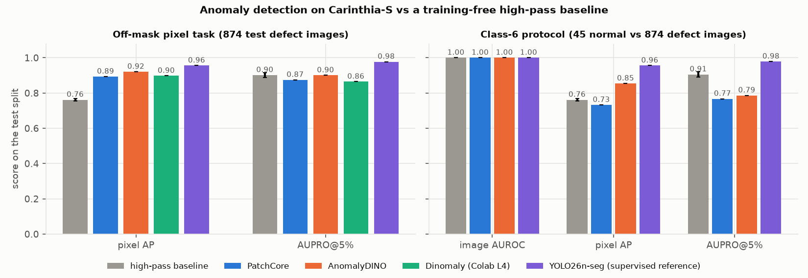
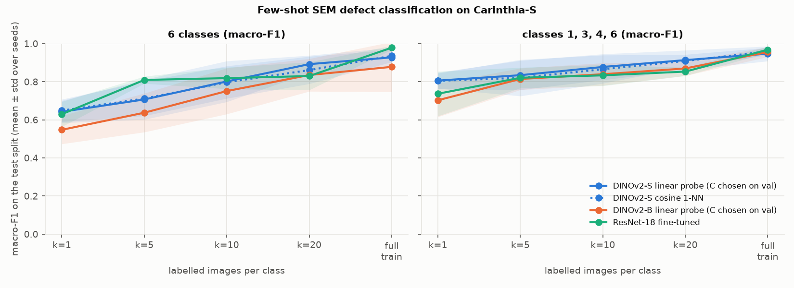
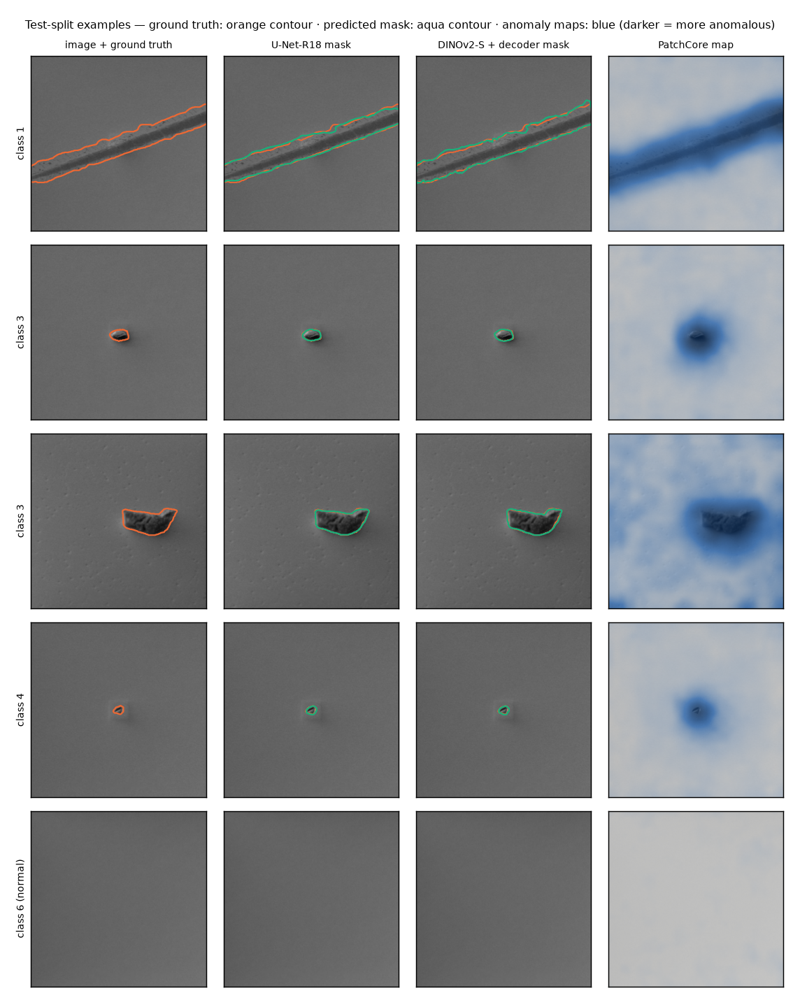
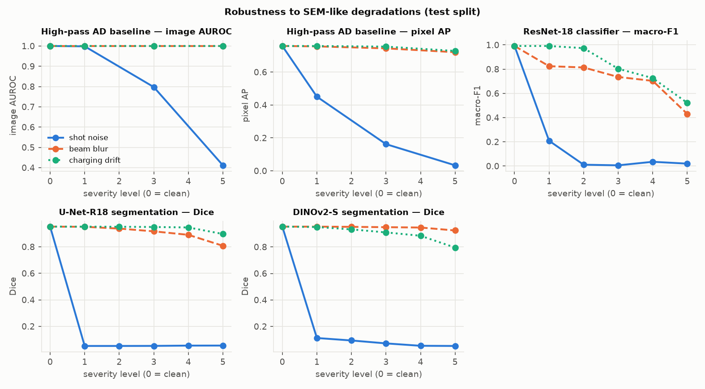
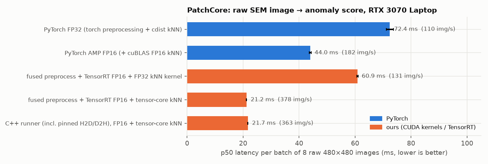
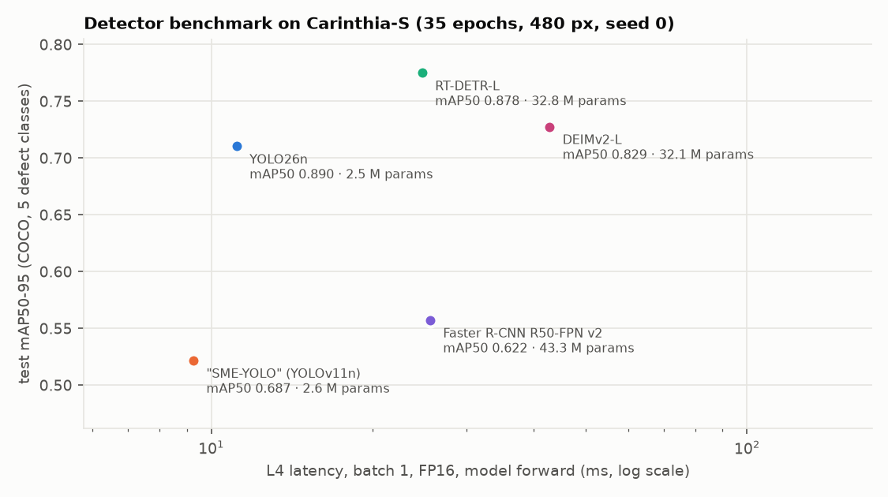

# REPORT — SEM defect inspection on Carinthia-S + a C++/CUDA/TensorRT inference engine

> Technical record of the benchmark: 61 local runs (49 GPU + 12 CPU) on an RTX 3070 Laptop GPU and three
> Colab L4 jobs (Dinomaly, YOLO26n-seg, a 5-model detector benchmark, §4.8). Every number below comes from
> `outputs/` via `docs/results.md` (`scripts/collect_results.py`) and `docs/benchmarks.md`
> (`scripts/report_bench.py`).

## 1. Data actually used

| Item | Value |
|---|---|
| Dataset | Carinthia-S, Zenodo 10.5281/zenodo.16895427 (Kofler & Hasić, 2025), CC BY 4.0 — the only dataset used |
| Download | `data.zip` 139,225,942 B, md5 `3a41242574635cf1302fab15accb7730` (verified locally and again on the Colab VM) + description HTML |
| Content | 4,591 grayscale 8-bit 480×480 SEM images of defects on one production layer of unstructured wafers, one expert-validated binary mask per image |
| Classes | 1: 55 · 2: 8 · 3: 4,008 · 4: 289 · 5: 4 · 6: 227 ("no visible defect", SEM mis-alignment) |
| Pre-processing | crop the 3-px black right border → 477×477 (rows 1–477, cols 0–476); area (adaptive-average) resize to the model size; grey → 3 channels, ImageNet normalisation; masks thresholded at >127 |
| Splits | stratified per class, train/val/test 60/20/20 with ≥ 1 val/test image per class (seed 0: train 2,753 / val 919 / test 919; class 5 = 2/1/1, class 2 = 4/2/2); split seeds 1 and 2 used for the few-shot probes |
| Few-shot supports | drawn from train only, nested across k ∈ {1, 5, 10, 20}, 5 support seeds; k capped by availability (class 2 ≤ 4, class 5 ≤ 2 train images) |
| Anomaly protocol | normal = class 6. Fit on the 136 class-6 train images (or k of them); test = test split (45 normal, 874 defective). One class-6 image with a 50-px mask is excluded from the AD protocol |
| Not used | MIIC (research-only licence) and MVTec AD 2 (size/registration): loader stubs only; original Carinthia (subset of Carinthia-S) |

Full analysis (duplicates, mask encodings, border, defect sizes, framing-square artefact):
[docs/dataset_analysis.md](docs/dataset_analysis.md).

## 2. Methods (all own implementations in `src/semdefect/` unless marked)

* **Few-shot / linear-probe classification.** Frozen DINOv2 ViT-S/14 and ViT-B/14 at 224 px (FP32
  features, all splits); descriptor = [CLS ; mean patch token]; L2-normalised logistic regression with
  balanced class weights and C selected on the labelled val split from {0.01, 0.1, 1, 10, 100} (per
  backbone, split and k; optimistic for few-shot), an untuned C = 1 row, CL2N nearest prototype, and a
  cosine 1-NN reference.
* **Fine-tuned CNN baselines.** ResNet-18 (ImageNet) on the full train split (3,000 steps, bs 64, AdamW
  3e-4, cosine, CE weights ∝ freq^-0.5; best checkpoint by val macro-F1; 3 seeds) and on k-shot supports
  (300 steps, bs ≤ 32; **last checkpoint**, no model selection on the labelled val split; 5 support seeds,
  split 0); ConvNeXt-T full (1 seed). Dihedral + intensity augmentation.
* **Segmentation.** U-Net from scratch (7.8 M params) and with an ImageNet ResNet-18 encoder at 256 px;
  frozen DINOv2 ViT-S/14 at 448 px (last 4 blocks) + light conv decoder with a full-resolution stem
  (0.79 M trainable). BCE + soft Dice, 6,000 steps; best checkpoint by validation Dice.
* **Anomaly detection.** Sanity baseline first: a training-free high-pass energy map (Gaussian high-pass,
  local RMS, σ = 4 px, fixed a priori). Then PatchCore (WRN-50 layer 2+3, 3×3 aggregation, 1024-d, 10 %
  greedy coreset); AnomalyDINO-style patch kNN (DINOv2 ViT-S/14 at 448 px, rotation-augmented reference
  bank, cosine distance, mean of top-1 % patches); Dinomaly (frozen DINOv2-reg ViT-S/14 at 280 px, noisy
  MLP bottleneck, 8 linear-attention decoder blocks, hard-mining cosine loss, 10k steps; Colab L4, §4.8).
  EfficientAD is implemented and smoke-tested but not part of the reported runs (compute budget). Two
  protocols: (i) class-6 normals vs defect images (image level); (ii) the lead task — normal references = class-6 train images +
  patches > 16 px from the defect masks of 300 train defect images (Dinomaly: the same images, with the loss
  masked to those patches), pixel-level evaluation on the 874 test defect images only.
* **Metrics.** Accuracy, macro-F1 (6 classes and the 4 classes with ≥ 55 images), balanced accuracy;
  per-image Dice/IoU over defect images, micro IoU, false-positive rate on empty-mask images; image
  AUROC (overall and per defect class), pixel AUROC, AUPRO up to 30 % and 5 % FPR, pixel average
  precision. Mean ± sample std over seeds; 95 % image-bootstrap CIs (2,000 resamples).
* **Robustness.** Poisson shot noise (dose 200 → 10 e⁻ at full scale), Gaussian beam blur (σ 0.5 → 3 px),
  low-frequency charging drift (5 → 30 % of full scale); levels 1/3/5 for the training-free AD baseline
  (CPU), 1–5 for the seed-0 classifier and segmenters. No model was trained with noise augmentation.
* **Colab L4 runs.** YOLO26n-seg (Ultralytics, AGPL-3.0) on the masks and a detector benchmark
  (YOLO26n, "SME-YOLO", RT-DETR-L, Faster R-CNN R50-FPN v2, DEIMv2-L) — §4.8.

## 3. Engineering (Part B — C++/CUDA/TensorRT)

* One kernel source (`src/semdefect/kernels/cuda/*.cuh`) compiled by NVRTC (CuPy prototype) and nvcc 12.8
  (static library, pybind11 module, C++ runner); native sm_86.
* Kernels: fused SEM preprocessing (uint8/uint16 → crop → area/bilinear resize → normalise → 3 ch);
  fused tiled L2 + top-k kNN (FP32, split-bank grid); tensor-core FP16 top-1 kNN (WMMA, FP32 accumulate);
  anomaly-map post-processing (sqrt → bilinear upsample → separable Gaussian, reflect padding).
* TensorRT 10.8 (pip wheels): ONNX export of the PatchCore embedder; FP32/FP16/INT8 (entropy calibration)
  engines; C++ runner loading `nvinfer_10.dll` at run time (Apache-2.0 public headers, no developer login),
  pinned host memory, multiple streams/contexts, batching, optional CUDA-graph replay, score + map outputs.
* Verification: 28 GoogleTests (kernels vs double-precision CPU references), 40 GPU parity pytests,
  38 CPU pytests, ruff, CI (lint + CPU tests).
* Benchmark protocol: every speed-up against a precision-matched PyTorch baseline
  (FP32 vs FP32; FP16 kernels/TensorRT vs AMP FP16 + cuBLAS FP16 kNN), reported as precision gain ×
  engineering gain; 3 timing rounds (mean ± sd); full 136-normal bank and all 919 test images.

## 4. Results

### 4.1 How hard is anomaly detection on Carinthia-S? (training-free baseline)

| Protocol (3 split seeds) | image AUROC | pixel AUROC | AUPRO@30 % | AUPRO@5 % | pixel AP |
|---|---|---|---|---|---|
| Class-6 normals vs defect images (45 vs 874) | 1.000 ± 0.000 | 0.984 ± 0.002 | 0.978 ± 0.003 | 0.906 ± 0.014 | 0.762 ± 0.007 |
| Pixel localisation on the 874 defect images | — | 0.983 ± 0.002 | 0.977 ± 0.003 | 0.902 ± 0.015 | 0.762 ± 0.007 |

A Gaussian high-pass residual's local RMS — no training data — separates every class-6 test image from
every defect image. The class-6 images are featureless surfaces, so that protocol measures texture
detection. Pixel AUROC and AUPRO@30 % are also near ceiling because they are dominated by easy smooth
background; **pixel AP and AUPRO@5 % leave headroom** and are the metrics learned detectors must beat.

### 4.2 Few-shot classification with frozen DINOv2 features

Full tables (all methods, k = 1/5/10/20/full, both metrics, selected C, bootstrap CIs) in
`docs/results.md`. Headline (mean ± sd over 3 split seeds × 5 support seeds):

| Method | k=1 (6 cl. / 4 cl.) | k=20 (6 / 4) | full train (6 / 4) |
|---|---|---|---|
| DINOv2-S linear probe, C chosen on val | 0.643 ± 0.058 / 0.806 ± 0.043 | 0.892 ± 0.046 / 0.914 ± 0.052 | 0.928 ± 0.051 / 0.948 ± 0.039 |
| DINOv2-S linear probe, untuned C = 1 | 0.594 ± 0.063 / 0.789 ± 0.075 | 0.788 ± 0.085 / 0.895 ± 0.048 | 0.943 ± 0.030 / 0.942 ± 0.023 |
| DINOv2-S cosine 1-NN | 0.649 ± 0.059 / 0.805 ± 0.040 | 0.861 ± 0.072 / 0.909 ± 0.034 | 0.936 ± 0.032 / 0.960 ± 0.020 |
| DINOv2-B linear probe, C chosen on val | 0.548 ± 0.074 / 0.703 ± 0.087 | 0.835 ± 0.086 / 0.870 ± 0.038 | 0.878 ± 0.131 / 0.956 ± 0.025 |
| DINOv2-B linear probe, untuned C = 1 | 0.539 ± 0.062 / 0.702 ± 0.086 | 0.661 ± 0.050 / 0.842 ± 0.027 | 0.893 ± 0.043 / 0.923 ± 0.019 |

Observations: (i) tuning C on val is essential for ViT-B (k=20: 0.835 vs 0.661) but ViT-B stays below
ViT-S in the k-shot regime even when tuned, so its deficit with C = 1 is only partly a regularisation
artefact; (ii) val-selected C is not uniformly better on test (full train ViT-S: 0.928 vs 0.943
untuned) because val holds 1–2 images of classes 2 and 5; (iii) a training-free cosine 1-NN matches the
best probe; (iv) CL2N prototypes saturate early and collapse on the full, extremely imbalanced train set
(6-class 0.457 ViT-S); (v) 6-class macro-F1 has wide image-bootstrap CIs (≈ ± 0.18 at k=20), so the 4-class
metric is the one to compare.

### 4.3 Fine-tuned classifiers vs frozen features

**Paired k-shot comparison on split 0** (identical support sets and test images; mean ± sd over 5 support
seeds; 6-class / 4-class macro-F1):

| model / method | k=1 | k=5 | k=10 | k=20 |
|---|---|---|---|---|
| DINOv2-S linear probe (C on val) | 0.646 ± 0.045 / 0.814 ± 0.035 | 0.737 ± 0.111 / 0.852 ± 0.083 | 0.767 ± 0.109 / 0.840 ± 0.058 | 0.889 ± 0.029 / 0.900 ± 0.013 |
| DINOv2-S cosine 1-NN | 0.646 ± 0.045 / 0.815 ± 0.033 | 0.739 ± 0.106 / 0.854 ± 0.106 | 0.823 ± 0.073 / 0.859 ± 0.057 | **0.947 ± 0.010 / 0.921 ± 0.015** |
| DINOv2-B linear probe (C on val) | 0.543 ± 0.049 / 0.672 ± 0.104 | 0.701 ± 0.106 / 0.825 ± 0.065 | 0.741 ± 0.102 / 0.817 ± 0.063 | 0.897 ± 0.035 / 0.862 ± 0.026 |
| ResNet-18 fine-tuned (last checkpoint) | 0.630 ± 0.066 / 0.737 ± 0.117 | **0.810 ± 0.019** / 0.821 ± 0.054 | 0.819 ± 0.057 / 0.834 ± 0.055 | 0.830 ± 0.073 / 0.853 ± 0.022 |

**Full training split** (test split 0):

| model | macro-F1 (6) | macro-F1 (4) | 95 % CI (6), seed 0 | accuracy | F1 class 1 (n=11) |
|---|---|---|---|---|---|
| ResNet-18 fine-tuned, 3 seeds | 0.979 ± 0.011 | 0.968 ± 0.016 | [0.658, 1.000] | 0.995 ± 0.002 | 0.89 ± 0.06 |
| ConvNeXt-T fine-tuned, 1 seed | 0.969 | 0.953 | [0.633, 0.989] | 0.995 | 0.81 |
| DINOv2-S linear probe (3 split seeds) | 0.928 ± 0.051 | 0.948 ± 0.039 | — | — | — |
| DINOv2-S cosine 1-NN (3 split seeds) | 0.936 ± 0.032 | 0.960 ± 0.020 | — | — | — |

With few labels, frozen DINOv2-S features beat fine-tuning: at k = 20 the training-free cosine 1-NN reaches
0.921 (4-class) vs 0.853 for a fine-tuned ResNet-18 on the same supports; only at k = 5 is ResNet-18 ahead on
the 6-class metric, inside the large support-seed spread. With the full 2,753-image train split, fine-tuning
wins (ResNet-18 0.979 / 0.968 vs DINOv2-S 0.928–0.943 / 0.948–0.960). The 6-class CIs span ~0.35 because
classes 2 and 5 have 2 and 1 test images; ConvNeXt-T is not better than ResNet-18 here.

### 4.4 Segmentation

| model (test split, 874 defect + 45 empty-mask images) | Dice (mean, defect images) | 95 % CI (seed 0) | IoU (mean) | IoU (micro) | FP rate on empty-mask images |
|---|---|---|---|---|---|
| U-Net from scratch, 1 seed | 0.950 | [0.943, 0.955] | 0.913 | 0.903 | 0.000 |
| U-Net + ResNet-18 encoder, 3 seeds | 0.952 ± 0.000 | [0.946, 0.957] | 0.918 ± 0.001 | 0.908 ± 0.001 | 0.000 ± 0.000 |
| Frozen DINOv2-S + light decoder (0.79 M trainable), 3 seeds | 0.953 ± 0.000 | [0.947, 0.958] | 0.919 ± 0.000 | 0.912 ± 0.001 | 0.000 ± 0.000 |

All three segmenters are statistically indistinguishable (overlapping bootstrap CIs; seed sd < 0.0005) and
none marks a single pixel on the 45 empty-mask test images. A frozen DINOv2-S with a 0.79 M-parameter
decoder matches fully trained U-Nets. The YOLO26n-seg comparison (Colab) is in §4.8.

### 4.5 Learned anomaly detectors

**Lead task — localisation on the 874 test defect images, off-mask normals** (1 run each; the
high-pass row is mean ± sd over 3 split seeds):

| method | pixel AUROC | AUPRO@30 % | AUPRO@5 % | pixel AP |
|---|---|---|---|---|
| High-pass energy (training-free baseline) | 0.983 ± 0.002 | 0.977 ± 0.003 | 0.902 ± 0.015 | 0.762 ± 0.007 |
| PatchCore WRN-50 + off-mask normals | 0.996 | 0.976 | 0.875 | 0.893 |
| AnomalyDINO ViT-S/14 + off-mask normals | 0.997 | 0.981 | 0.900 | **0.921** |
| Dinomaly ViT-S/14-reg, loss masked to off-mask patches (Colab L4, 1 run) | 0.997 | 0.977 | 0.864 | 0.898 |
| *YOLO26n-seg score map — supervised reference, trained on the masks (Colab L4)* | *0.989* | *0.990* | *0.977* | *0.956* |

**Class-6 protocol** (45 normal vs 874 defect images): image AUROC 1.000 for the baseline, PatchCore and
AnomalyDINO with all 136 normals (bootstrap CI [1.000, 1.000]); pixel AP 0.762 / 0.732 / 0.854 and
AUPRO@5 % 0.906 / 0.767 / 0.786. Few-shot (1 reference image): AnomalyDINO pixel AP 0.840, PatchCore 0.618;
with 10 references 0.857 and 0.701 (AnomalyDINO k = 10 image AUROC 0.997, the only value below 1).

All three learned detectors beat the training-free baseline clearly on pixel AP (+0.13 PatchCore, +0.16
AnomalyDINO, +0.14 Dinomaly) when they are given off-mask normal patches from defect images, but **none beats
it on AUPRO@5 %** (PatchCore 0.875, Dinomaly 0.864, AnomalyDINO 0.900 vs 0.902): their gains are in pixel
ranking near defects, not in region recall at very low false-positive rates. A supervised YOLO26n-seg (trained
on the masks, so not an anomaly detector) shows the headroom: pixel AP 0.956, AUPRO@5 % 0.977. With class-6 normals only (texture-free references), PatchCore is below the
baseline on pixel AP.

### 4.6 Robustness to SEM-like degradations

| model (metric, clean) | shot noise L1 (dose 200) | L5 (dose 10) | blur L5 (σ 3 px) | charging L5 (30 %) |
|---|---|---|---|---|
| High-pass AD baseline (image AUROC 1.000 / pixel AP 0.759) | 0.998 / 0.451 | 0.411 / 0.033 | 1.000 / 0.721 | 1.000 / 0.728 |
| ResNet-18 classifier (macro-F1 0.991) | 0.209 | 0.020 | 0.430 | 0.521 |
| U-Net-R18 (Dice 0.952) | 0.052 | 0.055 | 0.808 | 0.897 |
| DINOv2-S segmenter (Dice 0.953) | 0.113 | 0.053 | 0.924 | 0.795 |

**Every trained model collapses at the mildest shot-noise level**: under dose-200 Poisson noise the
segmenters flag defects on 100 % (U-Net) / 97.8 % (DINOv2) of the empty-mask images and their Dice falls to
the value of an all-foreground mask; the classifier drops to macro-F1 0.21. None was trained with noise
augmentation, and the training-free high-pass detector degrades far more gracefully. Blur and charging
cost little up to level 3; at level 5 the frozen DINOv2 segmenter is the most blur-robust (0.924) and the
U-Net the most charging-robust (0.897).

### 4.7 Deployment engine (Part B)

**Speed-up decomposition** (RTX 3070 Laptop; p50 latency in ms, mean ± sd over 3 timing rounds; precision
gain = PyTorch FP32 / PyTorch FP16, engineering gain = PyTorch FP16 / ours):

| measurement | PyTorch FP32 | PyTorch FP16 | ours (FP16) | precision gain | engineering gain | total |
|---|---|---|---|---|---|---|
| kNN, PatchCore 1 image, N = 10k, D = 1024 | 4.69 ± 0.03 | 3.06 ± 0.01 | 1.37 ± 0.08 | 1.53× | 2.23× | 3.42× |
| kNN, PatchCore 1 image, N = 100k | 51.05 ± 0.43 | 25.33 ± 0.08 | 10.81 ± 0.07 | 2.02× | 2.34× | 4.72× |
| kNN, PatchCore 8 images, N = 10k | 35.04 ± 0.08 | 19.89 ± 0.09 | 11.59 ± 0.10 | 1.76× | 1.72× | 3.02× |
| kNN, PatchCore 8 images, N = 100k | 391.96 ± 0.95 | 199.07 ± 0.38 | 133.33 ± 1.61 | 1.97× | 1.49× | 2.94× |
| kNN, AnomalyDINO 1 image, N = 131k, D = 384 | 34.53 ± 0.28 | 26.27 ± 0.53 | 6.89 ± 0.22 | 1.31× | 3.81× | 5.01× |
| PatchCore end-to-end (raw uint8 → score), batch 1 | 11.91 ± 1.30 | 9.57 ± 0.56 | 3.79 ± 0.04 | 1.24× | 2.53× | 3.14× |
| PatchCore end-to-end, batch 8 | 72.42 ± 1.28 | 44.02 ± 0.39 | 21.19 ± 0.11 | 1.65× | 2.08× | 3.42× |

* **The FP32 tiled kNN kernel does not beat cuBLAS** on PatchCore shapes (0.77–1.02× vs `cdist + topk`;
  1.32× only for D = 384) — its value is zero extra memory (no M×N tile). The speed comes from the
  tensor-core FP16 top-1 kernel: 1.49–3.81× over a cuBLAS-FP16 + `topk` baseline, with top-1 index agreement ≥ 0.998 against FP32 (the FP16 PyTorch baseline: ≥ 0.994).
* End to end, TensorRT FP16 + fused preprocessing with the FP32 kNN kernel is *slower* than PyTorch AMP at
  batch 8 (60.9 vs 44.0 ms): the kNN dominates; only with the tensor-core kNN does the pipeline win (21.2 ms).
* **C++ runner** (pinned H2D → fused preprocess → TensorRT FP16 → tensor-core kNN → max → D2H, all 919
  test images, 3 repeats): batch 1 p50 3.90 ± 0.01 ms (250 img/s), batch 8 21.68 ± 0.06 ms (363 img/s),
  132–182 MiB VRAM; scores vs PyTorch FP32 r = 0.9999963, ΔAUROC 0.0000. Two streams add nothing at
  batch 8 (366 img/s). CUDA-graph replay: −3 % at batch 1 (3.658 vs 3.785 ms), none at batch 8; scores
  bit-identical.
* Runner anomaly maps (CUDA post-processing, 200 test images): pixel AP 0.79035 vs 0.79054 PyTorch,
  AUPRO@5 % 0.82300 vs 0.82307; max abs map difference 0.41 % of the range.
* Excluded: INT8. It was only checked at preliminary scale (32-image bank and calibration set, 120 test
  images), where its image scores correlated r = 0.984 with FP32, and was not run on the full split.
  The runner and map-parity results on a 120-image subset are superseded by the full-split runs above.
  Full tables: `docs/benchmarks.md`.

### 4.8 Colab L4 jobs: Dinomaly, YOLO26n-seg, detector benchmark

One Colab L4 session (NVIDIA L4 24 GB, torch 2.14.1 + CUDA 13.0, Python 3.13, Ultralytics 8.4.212);
Carinthia-S downloaded on the VM and md5-checked; same split files and metric code as the local runs.

**(a) Dinomaly ×1, off-mask task** — 10k steps in 13 min (fit 779 s); pixel AP 0.898, AUPRO@5 % 0.864,
pixel AUROC 0.997 (table in §4.5). It lands between PatchCore and AnomalyDINO on pixel AP and, like them,
below the training-free baseline on AUPRO@5 %.

**(b) YOLO26n-seg** (COCO-pretrained, 5 defect classes, class-6 images as background, 480 px, 35 epochs,
best-on-val checkpoint like the U-Nets; polygon labels reproduce the masks at mean IoU 0.9999). Evaluated with
this repo's metric code at the same resolutions as the local models:

| task (test split) | YOLO26n-seg | best local model |
|---|---|---|
| segmentation: Dice (mean) / IoU (micro) / FP rate on empty-mask images | 0.948 / 0.897 / 0.000 | DINOv2-S + decoder 0.953 / 0.912 / 0.000; U-Net-R18 0.952 / 0.908 / 0.000 |
| off-mask localisation: pixel AP / AUPRO@5 % (supervised vs unsupervised) | 0.956 / 0.977 | AnomalyDINO 0.921 / 0.900 |
| class-6 protocol: image AUROC | 1.000 | 1.000 (all) |
| classification from the top detection: macro-F1 6 / 4 classes, accuracy | 0.804 / 0.956 / 0.993 | ResNet-18 0.979 / 0.968 / 0.995 |

YOLO26n-seg segments almost as well as the U-Nets (Dice −0.004) with 2.7 M parameters; as a classifier it
misses the single class-5 test image (F1 0) and confuses 4 class-3 defects with class 1, so its 6-class
macro-F1 is far below ResNet-18's while its 4-class macro-F1 (0.956) is close.

**Batch-1 latency on the same L4** (p50 ms over 300 calls after 30 warm-ups; U-Net / PatchCore with random
weights — latency is weight-independent; PatchCore uses PyTorch kNN over a 38,740 × 1024 bank):

| model | params | model FP32 | model FP16 | e2e FP32 (host uint8 → host mask/map) | e2e FP16 |
|---|---|---|---|---|---|
| YOLO26n-seg (480 px) | 2.7 M | 11.34 | 12.32 | 12.35 | 13.47 |
| U-Net-R18 (256 px) | 14.3 M | 4.17 | 5.50 | 4.64 | 5.95 |
| PatchCore WRN-50 + kNN (256 px) | 24.9 M | 22.71 | 17.79 | 23.19 | 18.30 |

At batch 1 in eager PyTorch the two small models are launch-overhead-bound: FP16 (autocast / Ultralytics
half) is *slower* than FP32 for YOLO26n-seg and U-Net-R18; only PatchCore, dominated by the WRN-50 and the
kNN GEMM, gains (1.28×). YOLO26n-seg is not faster than the U-Net-R18 here despite 5× fewer parameters (it
runs at 480 px and its forward includes the NMS-free head's top-k). Compiled engines (TensorRT, as in §4.7)
would change these numbers; they were not built on Colab.

**(c) Detector benchmark** — five detectors trained and evaluated with the same protocol. Boxes =
bounding boxes of the 8-connected mask components (997 test boxes, 174 of them small, < 32² px); same split,
480 px input, **35 epochs for every model**, seed 0; pycocotools on the test split (100 detections per image);
GFLOPs from one counter for all models (PyTorch `FlopCounterMode`, math attention, 1×3×480×480); latency on the
L4, batch 1, FP16, 50 warm-up calls excluded, p50 of 300 calls (eager PyTorch, no TensorRT).

| model | params | GFLOPs | mAP50 | mAP50-95 | class-agnostic mAP50 | AP small | recall small @IoU 0.5 (class-aware / agnostic) | L4 latency p50 (model / e2e) | checkpoint |
|---|---|---|---|---|---|---|---|---|---|
| YOLO26n | 2.5 M | 3.3 | **0.890** | 0.710 | 0.930 | 0.093 | 0.487 / 0.793 | 11.1 / 13.3 ms | final (EMA) |
| "SME-YOLO" = stock YOLOv11n (see notes below) | 2.6 M | 3.6 | 0.687 | 0.522 | 0.930 | 0.086 | 0.479 / 0.782 | **9.3 / 10.9 ms** | final (EMA) |
| RT-DETR-L | 32.8 M | 63.5 | 0.878 | **0.775** | 0.928 | 0.265 | 0.709 / 0.793 | 24.7 / 25.3 ms | final (EMA) |
| Faster R-CNN R50-FPN v2 | 43.3 M | 366.0 | 0.622 | 0.557 | 0.921 | 0.088 | 0.674 / 0.707 | 25.6 ms (full forward incl. NMS) | final |
| DEIMv2-L (DINOv3-S; non-commercial licence) | 32.1 M | 71.0 | 0.829 | 0.728 | **0.933** | **0.291** | **0.713 / 0.810** | 42.8 ms (model + post-processor) | best stage-1 on val (official recipe) |

* **Localisation is a tie; the ranking is about class assignment.** All five reach class-agnostic mAP50
  0.921–0.933. The 5-class mAP differs by up to 0.27 because classes 2 and 5 contribute two of the five
  per-class APs from only 2 + 1 test images — YOLOv11n and Faster R-CNN lose there, not on localisation.
* **Small defects favour the DETR-style models**: AP small 0.29 (DEIMv2-L) and 0.27 (RT-DETR-L) vs ≤ 0.09 for
  YOLO26n, YOLOv11n and Faster R-CNN; DEIMv2-L has the best small-defect recall (0.81 class-agnostic).
* **Accuracy per millisecond**: YOLO26n gives 0.89 mAP50 at 11 ms and 3.3 GFLOPs; RT-DETR-L adds +0.065
  mAP50-95 and much better small-defect AP for 2.2× the latency; DEIMv2-L is the slowest in eager PyTorch.
* **Checkpoint selection on val is unreliable here**: Ultralytics' best-on-val checkpoints score lower on test
  than the final ones for YOLO26n (mAP50 0.686 vs 0.890) and YOLOv11n (0.468 vs 0.687), and slightly higher for
  RT-DETR-L (0.891 vs 0.878) — val, too, holds 1–2 images of the rare classes. DEIMv2's official recipe selects
  on val by design (its stage-2 never beat stage 1, so `best_stg1.pth` was used); this favours DEIMv2-L slightly.
* Caveats: one seed; class-aware numbers are dominated by 3 rare-class test images; latency is eager PyTorch at
  batch 1 (overhead-bound for the small models) — not comparable to the TensorRT numbers in §4.7.
* Implementation notes: "SME-YOLO" is reused exactly as in the author's earlier PCB defect-detection
  project, which implements it as a stock YOLOv11n (no public SME-YOLO code; NWD / EUCB / MSFA are TODOs
  there), so this row is a YOLOv11n result. Faster R-CNN = torchvision
  `fasterrcnn_resnet50_fpn_v2` with COCO weights as in that project. DEIMv2-L: official repo at commit
  `f005f50`, COCO checkpoint from its Hugging Face page (not gated; converted to the `-t` format, all backbone
  weights loaded — the repo's "Training DINOv3 from scratch" message is printed before `-t` loads them); two local
  patches (vertical-flip registration; torchvision ≥ 0.21 transform-API shim); the gated DINOv3 backbone file was
  not needed. **DEIMv2's code and weights are under the non-commercial DEIMv2 License** (not Apache-2.0).

**Colab compute**: one L4 session of 4.08 h (1.94 compute units/h → ≈ 7.9 CU). Per job (VM wall):
data download + md5 1 min, YOLO-seg data 0.6 min, Dinomaly 13.8 min ∥ YOLO26n-seg 20.7 min, evaluation 0.9 min,
latency 1.5 min, YOLO26n 8.9 min, YOLOv11n 7.1 min, RT-DETR-L 49.9 min, Faster R-CNN 66.0 min, DEIMv2-L 78.9 min.

## 5. Compute actually used

| where | runs | time | notes |
|---|---|---|---|
| Local RTX 3070 Laptop (8 GB), shared with other jobs through a VRAM-reservation wrapper | 49 GPU runs | 2.44 h in-job GPU time | per-run wall time and peak VRAM in `docs/results.md` |
| Local CPU (i7-12700H) | 12 CPU runs (few-shot probes, high-pass baselines) | ≈ 0.9 h logged; DINOv2 feature extraction dominates (ViT-B split 0 35 min, ViT-S split 0 12 min) | DataLoader workers ≤ 2, ≥ 8 GB free RAM gate |
| Colab L4 (one session) | (a) Dinomaly, (b) YOLO26n-seg + L4 latency, (c) 5 detectors | 4.08 h, ≈ 7.9 compute units | per-job wall times in §4.8 |

## 6. What worked, what did not, limitations, next steps

**Worked.**
* Frozen DINOv2-S features: best few-shot classifier (cosine 1-NN, no training) and a segmenter that
  matches U-Nets with 0.79 M trainable parameters; AnomalyDINO is the best detector on pixel AP, also with a
  single normal reference image.
* Detectors: localisation of these defects is easy for every modern detector (class-agnostic mAP50 0.92–0.93);
  RT-DETR-L / DEIMv2-L are clearly better on small defects; YOLO26n is the best accuracy-per-millisecond model.
* The deployment engine: 3.1–3.4× end-to-end over PyTorch FP32 and 2.1–2.5× over precision-matched PyTorch
  AMP, with image-score correlation r = 0.9999963 to PyTorch FP32 and pixel AP within 0.0002; GoogleTest/pytest parity suites.

**Did not work / negative results.**
* The class-6 anomaly protocol is not a benchmark: a training-free texture detector solves it (AUROC 1.000).
* Learned detectors do not beat that baseline on AUPRO@5 % in the off-mask task.
* All trained models fail under mild Poisson shot noise (no noise augmentation was used).
* The FP32 fused kNN kernel is not faster than cuBLAS; INT8 lost too much score fidelity.
* Dinomaly (masked loss) did not beat AnomalyDINO; YOLO26n-seg's classification misses the single class-5
  test image; checkpoint selection on the tiny-class val split misleads (detector benchmark).

**Limitations.**
* **Group leakage cannot be ruled out.** Filenames are UUIDs without wafer/lot metadata; pixel-hash and
  DINOv2 nearest-neighbour checks found no duplicates (test→train NN cosine distribution equals
  train→train), but defects from the same wafer may sit in train and test.
* **Tiny classes.** Classes 2 and 5 have 2 and 1 test images; per-class F1 for them is anecdotal and the
  6-class macro-F1 CIs are ~0.35 wide.
* **Few-shot hyper-parameters** are selected on a labelled val split of 919 images — optimistic for a
  real few-shot deployment; the untuned C = 1 row bounds the effect.
* Single runs for the learned AD methods, ConvNeXt-T and the scratch U-Net (compute budget).
* **One layer, unpatterned wafers.** No evidence about patterned layers (MIIC / MVTec AD 2 not used).
* Speed-ups are measured on one laptop GPU shared with other jobs (p99 tails can
  include contention).

**Next steps.**
1. Shot-noise / dose augmentation (and dose-aware denoising) in training; re-run §4.6.
2. A harder anomaly benchmark: patterned layers or defect-free regions with real process texture.
3. Wafer/lot-grouped splits if the dataset authors can provide metadata.
4. INT8 with ≥ 500 calibration images or explicit quantisation; FP16 kNN for top-k > 1.
5. Detectors: report per-class AP with CIs, merge or re-weight the two tiny classes, more seeds; TensorRT
   export of YOLO26n / RT-DETR-L for a like-for-like deployment comparison with §4.7.
