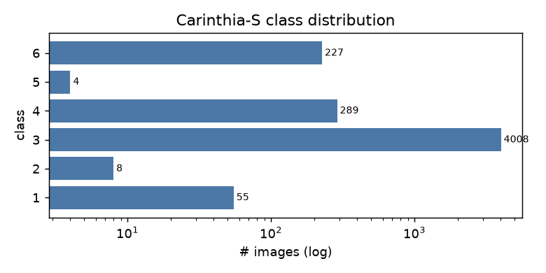
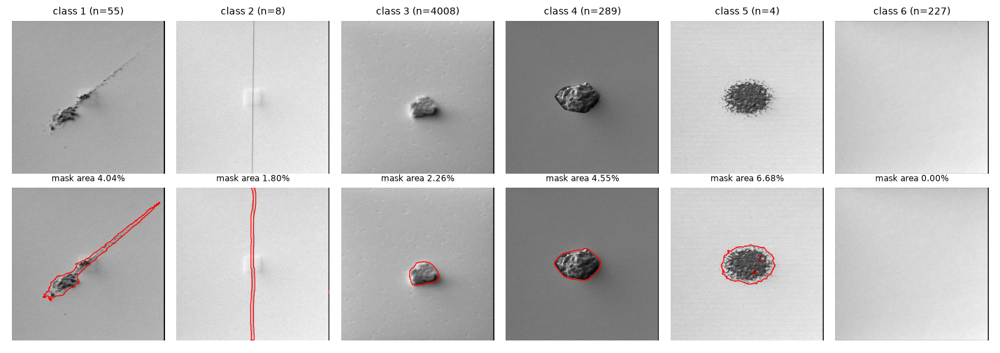

# Carinthia-S — dataset analysis and task design

All numbers below are produced by `scripts/analyze_dataset.py` (raw output: `docs/dataset_stats.json`,
figures: `docs/figures/`) on the full download (Zenodo 10.5281/zenodo.16895427, `data.zip`
md5 `3a41242574635cf1302fab15accb7730`).

## 1. What is in the data

| Property | Finding |
|---|---|
| Images | 4,591 grayscale 8-bit JPEG, all 480 × 480 px (mode `L`) — no 16-bit data |
| Masks | 4,591 PNG, 480 × 480; 4,587 mode `L`, 2 `RGB`, 2 `RGBA` (all four are class-6 masks with identical channels and are empty) |
| Classes | numeric ids only, no physical names: **1: 55, 2: 8, 3: 4,008, 4: 289, 5: 4, 6: 227** (87 % class 3) |
| Class 6 | documented as *"no visible defect"* (SEM mis-alignment images the area next to the defect). 226/227 masks are empty |
| Label/mask inconsistency | 1 class-6 image (`8b782473c99742e394df74b430412232`) has a 50-px mask region → excluded from the anomaly protocol (`AD_EXCLUDE`) |
| Mask encoding | nominally {0, 255}; 395 masks (class 3: 317, 1: 44, 4: 26, 2: 8) contain anti-aliased grey edge pixels. Thresholding at > 127 changes the foreground fraction by a median 0.02 % of the image (max 0.84 %) |
| Defect size (mask area, % of image) | class 3 median 1.7 % (p5 0.20 %, p95 4.4 %); class 1 7.9 %; class 4 7.4 % (p95 38 %); class 2 1.9 %; class 5 2.7 % |
| Components per mask | class 1: 91 % multi-component (mean 4.3); class 3: 11 % (max 45 fragments); class 5: always 1 |
| Position | defects are centred: mean centroid (0.49–0.51, 0.50–0.55), std ≈ 0.05 of the field of view |
| Border | the last 3 columns are black (column means 11.6, 4.9, 6.5 vs ~92 inside) → every image is cropped to the 477 × 477 square rows 1–477, cols 0–476 |
| Charging artefact | many defect images (and at least one class-6 image) show a faint square "framing" halo from the SEM alignment scan around the defect |
| Duplicates | 0 exact pixel duplicates. dHash collisions (401 groups) and 64×64 correlation (class-6 median r = 0.97) are driven by the featureless, smoothly shaded class-6 surfaces, not by re-imaged sites. After high-pass filtering (σ = 8 px) of the central 240 px, only 2 defect-image pairs exceed r = 0.8 and visual inspection shows distinct particles → no near-duplicate grouping was needed |
| Global intensity | mean grey level ≈ 97–101 for all classes; per-image std: class 6 5.6, class 3 9.4, class 4 15.5 (the defect itself raises contrast) |

## 2. Tasks the data supports (and how they are set up)

**Splits.** Deterministic, stratified per class, train/val/test = 60/20/20 with at least one val and
one test image for every class with ≥ 3 images (`src/semdefect/data/splits.py`; committed under
`data/splits/`). Seed 0: train {1:33, 2:4, 3:2404, 4:173, 5:2, 6:137}, val/test {1:11, 2:2, 3:802,
4:58, 5:1, 6:45}. Seeds 1, 2 are provided for split-variance studies.

**A. Defect classification (6 classes, incl. "no visible defect").** Macro-F1 is the headline metric
because accuracy is dominated by class 3. Classes 2 (8 images) and 5 (4 images) make per-class F1 on
the test set extremely noisy (2 and 1 test images): results are reported both as 6-class macro-F1
and per class, never as a single accuracy.

**B. Few-shot classification (k = 1, 5, 10, 20 per class).** Supports are drawn from the *train*
split only, nested across k (support₁ ⊂ support₅ ⊂ …) and repeated for 5 seeds; queries are the full
test split. Classes with fewer train images than k use all of them (`k_eff` is recorded: class 2 has
4 and class 5 has 2 train images, so k ≥ 5 is capped for them).

**C. Defect segmentation.** Expert binary masks for classes 1–5; class-6 images (empty masks) stay in
training as negatives. Metrics: per-image IoU/Dice over defect images, dataset-level (micro) IoU/Dice,
and the image-level false-positive rate on empty-mask images.

**D. Unsupervised anomaly detection.** *Defect-free images do exist*: class 6. Protocol: fit on the
136 class-6 train images (optionally only k of them = few-shot AD), evaluate on the test split
(45 normal vs 874 defective): image AUROC (overall and per defect class), pixel AUROC and AUPRO
(FPR ≤ 0.3) at 224 × 224. Optional, principled normal-pool augmentation for memory-bank methods:
add patches of *train* defect images whose (dilated by 16 px) cell contains no mask pixel.

**Limitations to state with every AD result.**
1. "Normal" images come from a *different situation* (tool mis-alignment) than the defect images; any
   systematic acquisition difference (e.g. the framing-square halo that often surrounds real defects)
   is a potential shortcut. Pixel-level AUPRO inside defect images is the less shortcut-prone metric.
2. Only 45 normal test images → image AUROC has a wide confidence interval (report bootstrap CIs).
3. All images are from one production layer on unpatterned wafers; nothing here measures transfer to
   patterned layers (MIIC / MVTec AD 2 stubs exist for that, see DATA.md).

## 3. Robustness hooks

`src/semdefect/robustness.py` adds physically motivated degradations at 5 severities each:
Poisson shot noise (dose 200 → 10 e⁻ at full scale), Gaussian beam blur (σ 0.5 → 3 px) and
low-frequency charging drift (smooth random field + slow-scan ramp, amplitude 5 → 30 % of full scale).
Evaluation sweeps are deterministic (per-batch seeded generators).
